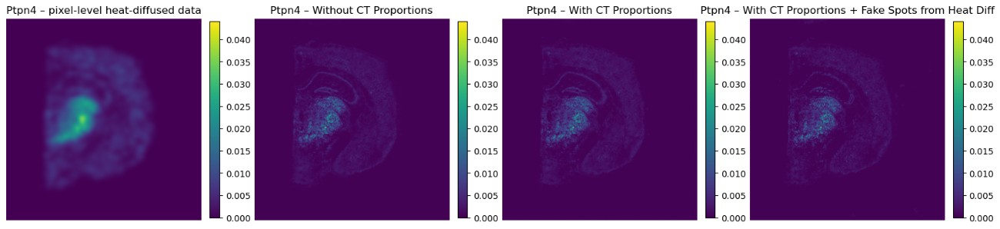
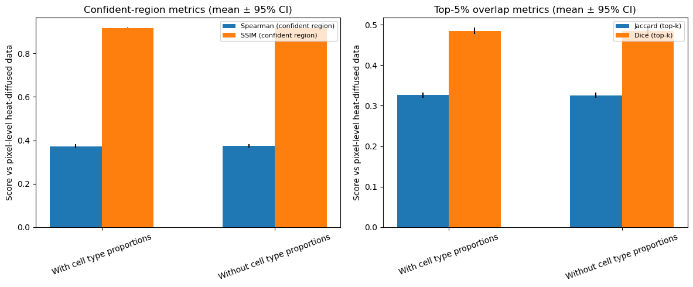

# iSTAR-C: Cell-Type-Aware Super-Resolution Spatial Transcriptomics

Team project for BMCS 4480 (Columbia University) by **Smriti Vaidyanathan** and **Mahsa Mohajeri**.

iSTAR-C extends [iSTAR](https://github.com/daviddaiweizhang/istar) (Zhang et al., 2024), which predicts pixel-level gene expression from histology images, by adding biologically informed supervision for cell types:

- **Cell-type head:** a new output head trained on spot-level cell-type proportions inferred with [Starfysh](https://github.com/azizilab/starfysh).
- **Weak supervision outside spots:** optional heat-diffusion pseudo-labels ("fake HD spots") that extend the training signal beyond measured Visium spots.

The goal is a model that keeps iSTAR's histology-driven gene-expression mapping while also producing spatially resolved cell-type estimates.

## Team and contributions

- **Mahsa Mohajeri:** built the mouse brain cell-type marker set, generated the pixel-level heat-diffusion gene maps used as pseudo-labels, and built the iSTAR vs. heat-diffusion evaluation.
- **Smriti Vaidyanathan:** added the cell-type classification head and loss to iSTAR, ran Starfysh to infer spot-level cell-type proportions, and set up the iSTAR training runs.
- Both contributed to the heat-diffusion and comparison notebooks.

## Results

Evaluated on the 10x Genomics Visium adult mouse brain section, comparing predicted gene maps against pixel-level heat-diffused expression.

- Adding cell-type supervision leaves gene-expression accuracy essentially unchanged: Spearman correlation, SSIM, and top-5% Jaccard/Dice overlap are nearly identical with and without cell-type proportions.
- The model gains pixel-level cell-type estimates at no measurable cost to gene-expression imputation.
- Limitation: the reference is heat-diffused spot data rather than true single-cell resolution measurements, so these metrics measure agreement with a smoothed pseudo-ground truth.

## Directory Guide
- **data/signatures.csv**: mouse brain cell-type marker signatures used by Starfysh.
- **data/gene-names.txt**: the ~1,000 highly variable genes used for heat diffusion and training.
- **docs/**: figures used in this README.
- **notebooks/cell_marker_data_analysis.ipynb**: explores marker lists and expression patterns used downstream.
- **notebooks/cell_segmentation_comparison.ipynb**: compares segmentation outputs across methods.
- **notebooks/dataset_creator.ipynb**: assembles inputs into the format Starfysh/iSTAR expect.
- **notebooks/dataset_exploration.ipynb**: quick EDA of the spatial dataset prior to modeling.
- **notebooks/heat_diffusion_pixel_level_only.ipynb**: generates pixel-level heat-diffused gene maps from spot data.
- **notebooks/istar_input_maker.ipynb**: builds iSTAR-ready inputs from Starfysh outputs (paths configurable inside).
- **notebooks/istar_vs_heatdiffusion.ipynb**: compares original iSTAR outputs with heat-diffusion variants.
- **notebooks/istar_vs_heatdiffusion_cleaned_up.ipynb**: cleaned comparison workflow for iSTAR vs heat diffusion.
- **notebooks/starfysh.ipynb**: runs the Starfysh pipeline to infer cell-type proportions.
- **src/istar_files_we_changed/hipt_model_utils.py**: utilities for loading and running the HIPT vision backbone. (changed to allow for weights_only=True)
- **src/istar_files_we_changed/impute.py**: trains the iSTAR model and handles optional CT supervision and fake HD spots.
- **src/istar_files_we_changed/plot_imputed.py**: visualizes predicted gene expression maps and cell type proportions.
- **src/istar_files_we_changed/run.sh**: main pipeline driver invoked by other scripts; forwards training flags to `impute.py`.
- **src/istar_files_we_changed/run_demo.sh**: example script for running the demo configuration.
- **src/istar_files_we_changed/run_visium_mouse_brain.sh**: convenience wrapper for the Visium mouse brain experiment with tunable loss weights.

## Key Parameters
- Heat diffusion Gaussian multiplier: set `sigma_mult` in `make_pixel_gene_maps` inside `notebooks/heat_diffusion_pixel_level_only.ipynb` (defaults to 0.7) to control the Gaussian blur applied to each spot.
- Visium mouse brain runner (`src/istar_files_we_changed/run_visium_mouse_brain.sh`): configure `prefix` (output/work dir), `data_dir` (heat-diffused inputs), `use_ct_supervision`, `use_fake_hd_spots`, plus `hd_loss_weight` and `ct_loss_weight` before launching the pipeline.

## End-to-End Usage (Starfysh, Heat Diffusion, iSTAR)
1) Download the spatial output data from https://www.10xgenomics.com/datasets/mouse-brain-section-coronal-1-standard
2) Organize the data the way Starfysh expects:
   - `data/signatures.csv` (provided in this repository).
   - `data/visium_mouse_brain/` containing everything from the spatial outputs data folder mentioned above.
3) Once data is in that format, run `notebooks/starfysh.ipynb` to output and explore the predicted cell-type proportions; save the AnnData with inferred CT proportions somewhere accessible. (make sure you install starfysh)
4) To get heat-diffused genes, run `notebooks/heat_diffusion_pixel_level_only.ipynb`; it currently runs on the top ~1000 highly variable genes (same set used for training, listed in `data/gene-names.txt`); save the notebook outputs into a folder.
5) Clone the iSTAR repository:
   - `git clone https://github.com/daviddaiweizhang/istar.git`
   - Then add all the files inside this repository’s `src/istar_files_we_changed` into the cloned repo, replacing old versions and adding any new files.
6) Create a folder for iSTAR inputs/outputs; you can use `notebooks/istar_input_maker.ipynb`, replacing paths with your H5AD from `starfysh.ipynb`, and write its outputs to the folder you want iSTAR to read.
7) To train and get plots, run `src/istar_files_we_changed/run_visium_mouse_brain.sh` (or `sbatch src/istar_files_we_changed/run_visium_mouse_brain.sh`):
   - Set `prefix` to the folder where `istar_input_maker.ipynb` wrote files.
   - Set `data_dir` to the folder containing outputs from `heat_diffusion_pixel_level_only.ipynb`.
   - In `impute.py`, update the path in `adata = sc.read_h5ad("../results/st.h5ad")` to your `starfysh.ipynb` H5AD file.
   - Optional training knobs: `use_ct_supervision=true` adds the cell-type head/loss, `use_fake_hd_spots=true` trains on fake HD spots; adjust `hd_loss_weight` and `ct_loss_weight` accordingly. To match the original iSTAR behavior, set both flags to `false`.
8) Run the full pipeline with `run_visium_mouse_brain.sh`; the model trains and writes outputs to the `prefix` folder.
